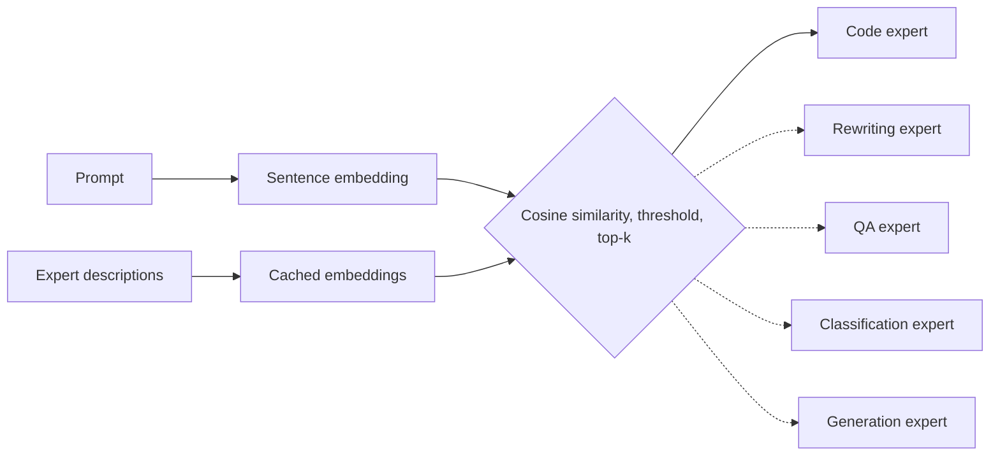

# Mixture-of-Experts Prompt Router

A minimal, readable illustration of the routing step in Mixture-of-Experts (MoE) systems. Instead of
a learned gating network, each prompt is embedded and sent to the expert model whose description is
most similar to it. For the prompt "Write a Python function to reverse a string", the router picks
the code expert with a cosine similarity of 0.354, ahead of the text-rewriting expert at 0.225.

## Why

MoE language models route each token to a few specialized experts through a learned gate, which is
hard to inspect. Replacing the gate with semantic similarity keeps the shape of the idea (one input,
many experts, a sparse choice) while making every routing decision explainable.

## How it works

Five experts are small pre-trained models, each with a one-sentence description:

| Expert | Model | Task |
|---|---|---|
| Code generation | `Salesforce/codet5-small` | text-to-text |
| Text rewriting | `mrm8488/t5-small-finetuned-common_gen` | text-to-text |
| Question answering | `distilbert-base-uncased-distilled-squad` | extractive QA |
| Sentiment classification | `distilbert-base-uncased-finetuned-sst-2-english` | classification |
| General generation | `sshleifer/tiny-gpt2` | text generation |

The descriptions are embedded once with `all-MiniLM-L6-v2` and cached. Each incoming prompt is
embedded with the same model, compared to every expert by cosine similarity, and routed to the
top-k experts whose score clears a threshold (0.3 by default).



## Limitations

- Routing quality depends entirely on how the expert descriptions are worded; there is no training.
- Routing happens once per prompt, not per token as in real MoE layers, and experts are separate
  models rather than sub-networks sharing a backbone.
- Similarity scores are low in absolute terms (the winning score above is 0.354), so the threshold
  needs tuning for new prompts and experts.
- This is a teaching demo, not a benchmark; no routing accuracy is measured.

## Citation

If you use this work, please cite:

```bibtex
@misc{chawla2025moerouter,
  author       = {Chawla, Naman},
  title        = {Mixture-of-Experts Prompt Router},
  year         = {2025},
  howpublished = {\url{https://github.com/palindromeRice/Moe_demo}}
}
```
